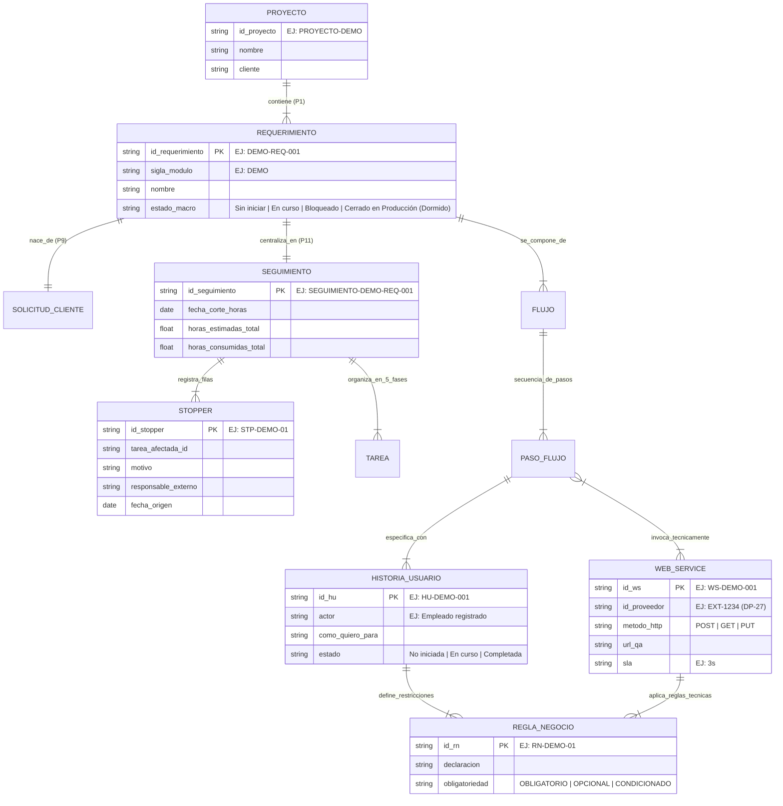

# Ontología y Modelo de Entidades del Dominio

**Documento normativo de arquitectura.** Define el modelo formal de entidades, cardinalidades, jerarquía funcional y convenciones de nomenclatura de la **LLM Wiki para Proyectos de Software**.

* **Autor:** Johan Benítez — Product Owner / Líder de Requerimientos
* **Principios rectores:** P1 a P11 (especialmente P1, P7, P8, P9 y P11)
* **Estado:** Aprobado

---

## 1. Definición Formal de Entidades

El dominio de la wiki se compone de **7 entidades de primer nivel** y **5 sub-entidades/componentes estructurales**, categorizadas según su naturaleza y lugar de residencia:

| ID | Entidad | Naturaleza | Dónde reside | Descripción |
| :---: | :--- | :--- | :--- | :--- |
| **E-01** | **Proyecto** | Raíz del sistema | `00-VISION.md` / Bóveda | Entidad contenedor raíz de un cliente en común. 1 wiki por proyecto (P1). |
| **E-02** | **Requerimiento** | Entidad de Alcance | Folder del Requerimiento | Unidad funcional principal del producto (P8). Identificado por sigla y número correlativo. |
| **E-03** | **Seguimiento** | Documento Centralizador | `seguimiento-[sigla-req].md` | Fichero único por requerimiento que contiene las 5 fases, horas comparables y stoppers (P11). |
| **E-04** | **Flujo** | Entidad Funcional | Sección/Página del Requerimiento | Vertiente o mapa de navegación de una funcionalidad (ej. variaciones de un formulario según respuestas). |
| **E-05** | **Paso de Flujo** | Unidad de Interacción | Ficha dentro del Flujo | Paso específico del usuario dentro del flujo (`P-01`, `P-02`). Asocia WS e Historias de Usuario. |
| **E-06** | **Historia de Usuario (HU)** | Ficha de Especificación | `hu-[sigla]-[nnn].md` | Unidad de valor funcional para un actor en un paso del flujo. Solo referencia el ID canónico del WS que invoca; nunca su URL ni detalle técnico (§5, cierra B2-T09). |
| **E-07** | **Web Service (WS)** | Contrato Técnico | `ws-[sigla]-[nnn].md` | Contrato de integración técnica (Request/Response/SLA) invocado en un paso del flujo. **Una ficha por endpoint** (cierra B2-T05): si un mismo endpoint se invoca desde varias HU o pasos del mismo requerimiento, se referencia una sola ficha, nunca se duplica. Entre requerimientos distintos sí se duplica (DEC-07, P8: cada requerimiento es autocontenido). |
| **E-08** | **Regla de Negocio (RN)** | Restricción del Dominio | Ficha dentro de HU / WS | Restricción lógica indivisible (`RN-01`, `RN-02`). Entidad independiente con identidad propia. |
| **E-09** | **Stopper (STP)** | Sub-entidad de Bloqueo | Fila en `Seguimiento` | Impedimento externo rastreable con responsable y antigüedad. No genera archivo propio (DEC-12). |
| **E-10** | **Sprint** | Atributo de Filtrado | Campo en Tarea (`SPR-NN`) | Agrupación temporal opcional. No genera entidad ni documento propio (DEC-11). |
| **E-11** | **Actor** | Atributo de Rol | Campo en HU y Flujo | Perfil o rol de usuario que ejecuta la acción (ej. *Pensionado*, *Analista*). |
| **E-12** | **SolicitudCliente** | Insumo Inmutable | `requerimiento-cliente.md` | Solicitud original tal como la entregó el cliente. Inmutable (P9). |

---

## 2. Jerarquía Funcional de 5 Niveles y Cardinalidad

Las entidades se organizan en una **jerarquía funcional estricta de 5 niveles**, garantizando que ningún documento quede descontextualizado o huérfano:

$$\text{1. Requerimiento} \xrightarrow{1:N} \text{2. Flujo} \xrightarrow{1:N} \text{3. Paso de Flujo} \xrightarrow{1:N} \text{4. Historia de Usuario (HU)} \xrightarrow{1:N} \text{5. Regla de Negocio (RN)}$$

```
Level 1: [Requerimiento] (ej. DEMO-REQ-001 - Módulo de Reserva de Salas)
   │
   └── Level 2: [Flujo] (ej. Flujo Principal de Reserva de Sala)
         │
         └── Level 3: [Paso de Flujo] (ej. P-01: Consultar Disponibilidad de Sala)
               │     ├── Invocación Técnica: [Web Service] (ej. WS-DEMO-001)
               │     │
               └── Level 4: [Historia de Usuario] (ej. HU-DEMO-001: Reservar Sala)
                     │
                     └── Level 5: [Regla de Negocio] (ej. RN-DEMO-01: Anticipación Mínima de 2 Horas)
```

### Tabla Matriz de Cardinalidades

| Entidad Origen | Entidad Destino | Cardinalidad | Regla de Negocio y Restricción |
| :--- | :--- | :---: | :--- |
| **Proyecto** | **Requerimiento** | $1 : N$ | Un proyecto contiene muchos requerimientos. 1 wiki por proyecto (P1). |
| **Requerimiento** | **SolicitudCliente** | $1 : 1$ | Cada requerimiento nace de exactamente 1 solicitud inmutable de cliente (P9). |
| **Requerimiento** | **Seguimiento** | $1 : 1$ | Cada requerimiento tiene exactamente 1 documento centralizador de seguimiento (P11). |
| **Requerimiento** | **Flujo** | $1 : N$ | Un requerimiento se compone de 1 o varios flujos (vertientes según respuestas). |
| **Flujo** | **Paso de Flujo** | $1 : N$ | Un flujo se compone de una secuencia ordenada de pasos (`P-01`, `P-02`). |
| **Paso de Flujo** | **Web Service** | $0 : N$ | Un paso de flujo puede invocar 0, 1 o varios Web Services para su objetivo. |
| **Paso de Flujo** | **Historia de Usuario** | $1 : N$ | Cada paso en el flujo tiene asociadas sus Historias de Usuario correspondientes. |
| **Historia de Usuario** | **Regla de Negocio** | $1 : N$ | Una HU contiene 1 o varias Reglas de Negocio específicas (`RN-01`, `RN-02`). |
| **Web Service** | **Regla de Negocio** | $0 : N$ | Un WS contiene reglas de negocio técnicas de desarrollo (`RN-WS-01`). |
| **Seguimiento** | **Stopper** | $0 : N$ | El seguimiento contiene 0 o varios stoppers activos como filas (DEC-12). |

---

## 3. Diagrama Mermaid ER (Entity-Relationship)



---

## 4. Nomenclatura e Identificadores Canónicos 

Para garantizar que el agente nunca se pierda ni consuma documentos erróneos, se fija una sintaxis uniforme basada en la **sigla de dominio/módulo**:

### 4.1 Regla de Siglas de Módulo/Dominio
1. Toda sigla debe tener un **mínimo de 4 letras mayúsculas** (ej. `DEMO`).
2. Las siglas son únicas por módulo dentro de la wiki del proyecto.

### 4.2 Tabla de Prefijos Canónicos

| Entidad | Prefijo Canónico | Ejemplos de ID Canónico | Regla de Sintaxis |
| :--- | :--- | :--- | :--- |
| **Requerimiento** | `[SIGLA]-REQ-` | `DEMO-REQ-001` | Sigla + `-REQ-` + Correlativo 3 dígitos. |
| **Historia de Usuario** | `HU-[SIGLA]-` | `HU-DEMO-001` | `HU-` + Sigla + `-` + Correlativo 3 dígitos. |
| **Web Service** | `WS-[SIGLA]-` | `WS-DEMO-001` | `WS-` + Sigla + `-` + Correlativo 3 dígitos. |
| **Regla de Negocio** | `RN-[SIGLA]-` | `RN-DEMO-01` | `RN-` + Sigla + `-` + Correlativo 2 dígitos. |
| **Stopper** | `STP-[SIGLA]-` | `STP-DEMO-01` | `STP-` + Sigla + `-` + Correlativo 2 dígitos. |
| **Paso de Flujo** | `P-` | `P-01`, `P-02`, `P-03` | `P-` + Correlativo de 2 dígitos por flujo. |
| **Sprint** | `SPR-` | `SPR-01`, `SPR-02` | `SPR-` + Correlativo de 2 dígitos (Campo opcional). |

### 4.3 Nomenclatura de Archivos en el Sistema de Archivos
Todos los nombres de archivos `.md` en la wiki deben escribirse en **minúsculas con guiones**, manteniendo el tipo de ficha e ID canónico al inicio para asegurar ordenamiento alfabético en carpetas:

- Requerimiento Hoja Principal: `hoja-principal-demo-req-001.md`
- Documento Centralizador de Seguimiento: `seguimiento-demo-req-001.md`
- Flujo Funcional: `flujo-demo-001-reserva-de-sala.md`
- Historia de Usuario: `hu-demo-001-reservar-sala.md`
- Web Service: `ws-demo-001-consulta-disponibilidad-salas.md`

---

## 5. Protocolo de Colisión de Proveedor

El hallazgo de la auditoría identificó que proveedores o clientes llaman a sus Web Services con nombres ambiguos como `EXT-1234` o `WS 4`, colisionando con la nomenclatura de Historias de Usuario de la wiki.

### 5.1 Regla de Reserva Estricta del Prefijo `HU`
* **Queda prohibido utilizar el prefijo `HU` para cualquier entidad o documento que no sea una Historia de Usuario propia.**
* Ningún Web Service, contrato de integración o documento externo se nombrará con prefijo `HU`.

### 5.2 Atributo `id_proveedor`
Cuando un Web Service provenga de un tercero con una nomenclatura externa (ej. `EXT-1234` de un proveedor externo):
1. **ID Canónico en la Wiki:** Se renombrará al estándar canónico de la wiki (ej: `WS-DEMO-001`).
2. **Atributo de Mapeo:** La ficha del Web Service registrará explícitamente el campo:
   ```yaml
   id_canonical: WS-DEMO-001
   id_proveedor: "EXT-1234"
   proveedor: "[Nombre del sistema o proveedor externo]"
   ```

### 5.3 Regla de Traducción Durante la Ingesta de Notas
Cuando el PO entregue una nota que mencione informalmente *"si el WS 4 no responde"* o *"el servicio EXT-1234 falló"*:
* El agente **nunca creará un archivo llamado `EXT-1234`**.
* El agente traducirá automáticamente la mención al ID canónico enlazado: `[[ws-demo-001-nombre]]`, registrando la equivalencia en el log.

### 5.4 Identificador Estable de Web Service

La regla completa de identificador estable, inmutabilidad, resiliencia ante cambios de proveedor/URL/método, manejo de servicios "por definir" y el esquema YAML obligatorio de metadatos **vive en `REGLA-IDENTIFICADOR-WS.md`**, documento normativo dedicado a esta materia. Esta sección no la repite (P4, P11); solo fija su relación con el modelo de entidades: el `Web Service` (E-07) es el único punto donde cambian URL, método HTTP o proveedor, y las entidades `Paso de Flujo`, `Historia de Usuario` y `Regla de Negocio` referencian exclusivamente su ID Canónico.

→ Ver `REGLA-IDENTIFICADOR-WS.md` para la norma completa.

### 5.5 Granularidad del Web Service

Un Web Service es **una ficha por endpoint**, nunca una ficha que agrupe varios endpoints de un mismo proveedor. Dentro de un mismo requerimiento, si dos o más HU o pasos de flujo invocan el mismo endpoint, se referencian todos al mismo ID canónico — **no se crean fichas duplicadas** (P11). Entre requerimientos distintos, el mismo endpoint de proveedor sí genera una ficha nueva en cada requerimiento, porque cada requerimiento debe ser autocontenido y auditable de forma independiente (DEC-07, P8).

### 5.6 Frontera entre Historia de Usuario y Web Service 

La Historia de Usuario **nunca describe** el contrato técnico del Web Service que invoca. Su única responsabilidad respecto al WS es enlazar su ID canónico (sección "Web Service asociado" de `plantilla-historia-de-usuario.md`), con una frase de una línea sobre para qué lo usa ese paso. Todo lo demás — request, response, SLA, headers, reintentos, códigos de error — vive exclusivamente en la ficha del WS (`plantilla-contrato-ws.md`). Esta frontera es lo que permite que un cambio técnico del proveedor actualice un solo documento (DEC-32).

---

## 6. Matriz de Trazabilidad a los 5 Criterios de Éxito

Para cumplir el **Criterio de Validación de B2-T01**, se demuestra que cada uno de los 5 criterios de éxito del producto se traza directamente a entidades concretas del modelo:

| # | Criterio de Éxito del Producto | Entidades y Relaciones que lo Soportan | Mecanismo de Consulta del Agente |
|---|---|---|---|
| **1** | **¿Qué tenemos pendiente hoy? ¿Qué nos hace falta?** | `Requerimiento` $\rightarrow$ `Seguimiento` $\rightarrow$ `Tarea` $\rightarrow$ `Stopper` | El agente consulta `Seguimiento` filtrando tareas con `Estado == En curso \| Bloqueada` y stoppers con `Estado == Activo`. |
| **2** | **¿Qué porcentaje de avance tiene el Requerimiento X?** | `Requerimiento` $\rightarrow$ `Seguimiento` $\rightarrow$ `Fase` | El agente calcula horas consumidas vs estimadas por cada una de las 5 Fases de Ejecución en `Seguimiento`. |
| **3** | **¿Cuáles fueron los principales avances de la semana?** | `Seguimiento` $\rightarrow$ `Tarea.FechaReal` + Log de Ingesta | El agente escanea tareas de `Seguimiento` cuya `FechaReal` cae en la última semana. |
| **4** | **¿Qué contradicciones existen dentro o entre requerimientos?** | `Paso_Flujo` $\rightarrow$ `HU` $\rightarrow$ `WS` $\rightarrow$ `Regla_Negocio` | El agente compara la matriz de datos de entrada/salida de `WS` contra las `Reglas de Negocio` de la `HU`. |
| **5** | **Auditoría de Rol (recorrer flujo como usuario)** | `Actor` $\rightarrow$ `Flujo` $\rightarrow$ `Paso_Flujo` $\rightarrow$ `HU` $\rightarrow$ `WS` | El agente simula la navegación secuencia por secuencia (`P-01` a `P-N`) verificando que cada paso tenga su WS y HU completos. |

---

## 7. Verificación de Cumplimiento de Principios (P1 a P11)

- **P1 (Un proyecto, una wiki):** La entidad `Proyecto` restringe la wiki a un solo cliente/sistema.
- **P7 (Excel para horas contables):** `Seguimiento` solo guarda horas estimadas/ejecutadas totales y fecha de corte.
- **P8 (Alcance por requerimiento):** `HU`, `Flujo` y `WS` se vinculan obligatoriamente a 1 Requerimiento.
- **P9 (Solicitud cliente inmutable):** `SolicitudCliente` permanece como nodo de solo lectura.
- **P11 (Mínimo de documentos):** `Stopper`, `Tarea` y `Sprint` no generan archivos `.md` independientes; viven estructurados dentro de `Seguimiento`.
