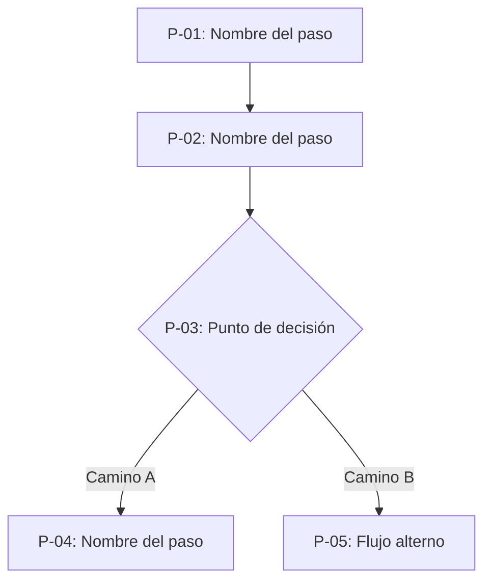
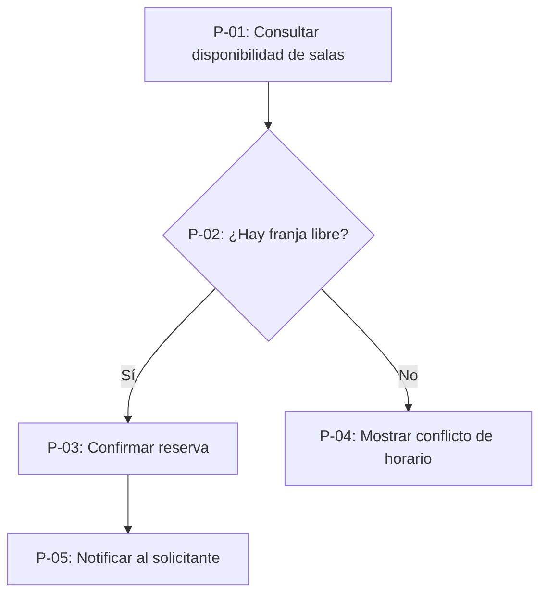

# Flujo Funcional — [Nombre del Flujo] ([SIGLA]-REQ-[NNN])

Plantilla normativa de Flujo. Un requerimiento tiene 1 o varios flujos (vertientes según respuestas del usuario). Todo flujo se documenta **siempre con diagrama Mermaid embebido** — nunca con herramienta externa de diagramación ni enlace a servicio de terceros (P2).

---

## 1. Cabecera

| Campo | Valor |
| :--- | :--- |
| **Requerimiento padre** | `[[SIGLA]-REQ-[NNN]]` |
| **Nombre del flujo** | `[Nombre — ej. "Flujo principal de reserva"]` |
| **Variación / vertiente** | `[Qué distingue a este flujo de otros del mismo requerimiento, si existen]` |

---

## 2. Diagrama Mermaid

---

## 3. Tabla de pasos

Una fila por paso. Todo paso declara sus HU y, si aplica, sus Web Services.

| Paso | Descripción | Actor | HU asociada(s) | WS invocado(s) |
| :---: | :--- | :--- | :--- | :--- |
| `P-01` | `[Qué ocurre en este paso]` | `[Rol]` | `[[hu-sigla-nnn-nombre]]` | `[[ws-sigla-nnn-nombre]]` |

---

## 4. Flujos alternos y de excepción

`[Descripción en prosa de caminos alternos o de error que el diagrama de la sección 2 ya representa como ramas. No repetir el diagrama en texto — solo aclarar la condición que activa cada rama.]`

---

## Ejemplo de referencia

Instancia ficticia y genérica, conforme a DEC-16. No corresponde a ningún cliente real.

**Flujo principal — Reserva de sala (`DEMO-REQ-001`)**

| Paso | Descripción | Actor | HU asociada | WS invocado |
| :---: | :--- | :--- | :--- | :--- |
| `P-01` | Consulta franjas libres por sala y fecha | Empleado registrado | `hu-demo-001-reservar-sala` | `ws-demo-001-consulta-disponibilidad-salas` |
| `P-02` | Punto de decisión — disponibilidad | Sistema | — | — |
| `P-03` | Confirma la reserva | Empleado registrado | `hu-demo-001-reservar-sala` | `ws-demo-002-crear-reserva` |

---

## Reglas de uso

1. **El diagrama es la fuente de la secuencia.** La tabla de pasos no reordena ni contradice el diagrama; lo complementa con actor y documentos asociados.
2. **Ningún paso queda sin HU o sin justificación de por qué no la tiene** (ej. paso puramente técnico de decisión del sistema).
3. **Las secciones vacías se omiten** (P11).
4. **Este documento no describe el contrato técnico del WS.** Solo referencia su ID canónico.
