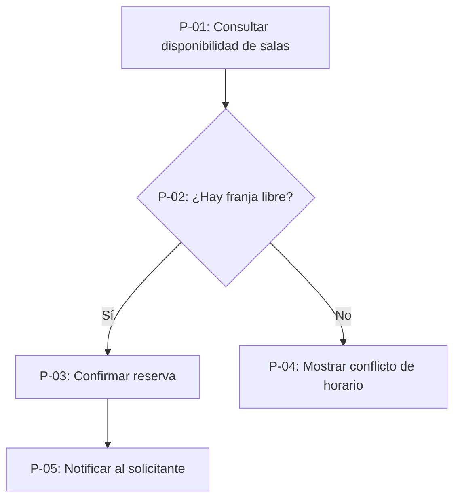

# Flujo Funcional — Reserva de sala (DEMO-REQ-001)

Todo flujo se documenta **siempre con diagrama Mermaid embebido** — nunca con herramienta externa de diagramación ni enlace a servicio de terceros (P2).

---

## 1. Cabecera

| Campo | Valor |
| :--- | :--- |
| **Requerimiento padre** | [[hoja-principal-demo-req-001]] (`DEMO-REQ-001`) |
| **Nombre del flujo** | Flujo principal de reserva |
| **Variación / vertiente** | Único flujo del requerimiento. No hay vertientes alternas. |

---

## 2. Diagrama Mermaid

---

## 3. Tabla de pasos

| Paso | Descripción | Actor | HU asociada(s) | WS invocado(s) |
| :---: | :--- | :--- | :--- | :--- |
| `P-01` | Consulta franjas libres por sala y fecha | Empleado registrado | `HU-DEMO-001` | `WS-DEMO-001` |
| `P-02` | Punto de decisión — disponibilidad de la franja elegida | Sistema | — (paso técnico de decisión) | — |
| `P-03` | Confirma la reserva sobre la franja libre | Empleado registrado | `HU-DEMO-001` | `WS-DEMO-002` |
| `P-04` | Muestra el conflicto de horario y ofrece volver a consultar | Sistema | `HU-DEMO-001` | — |
| `P-05` | Notifica la reserva registrada al solicitante | Sistema | `HU-DEMO-001` | — |

---

## 4. Flujos alternos y de excepción

- **Franja ocupada (`P-02` → `P-04`):** se activa cuando la franja elegida ya tiene una reserva confirmada. El flujo no falla: devuelve al empleado a la consulta de disponibilidad con el conflicto visible.
- **Reserva con menos de dos horas de anticipación:** la validación ocurre en `P-03` antes de invocar el servicio de registro, y devuelve el mismo tratamiento de conflicto de `P-04`. La regla está en `RN-01` de `HU-DEMO-001`.
